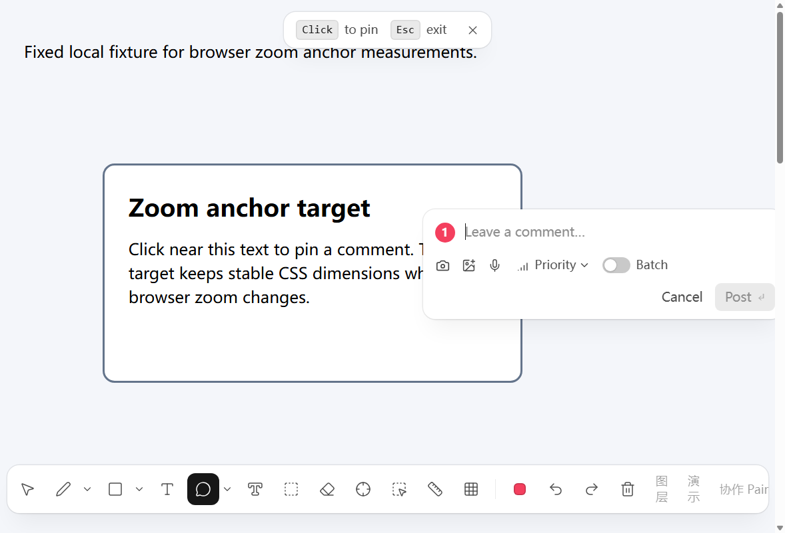
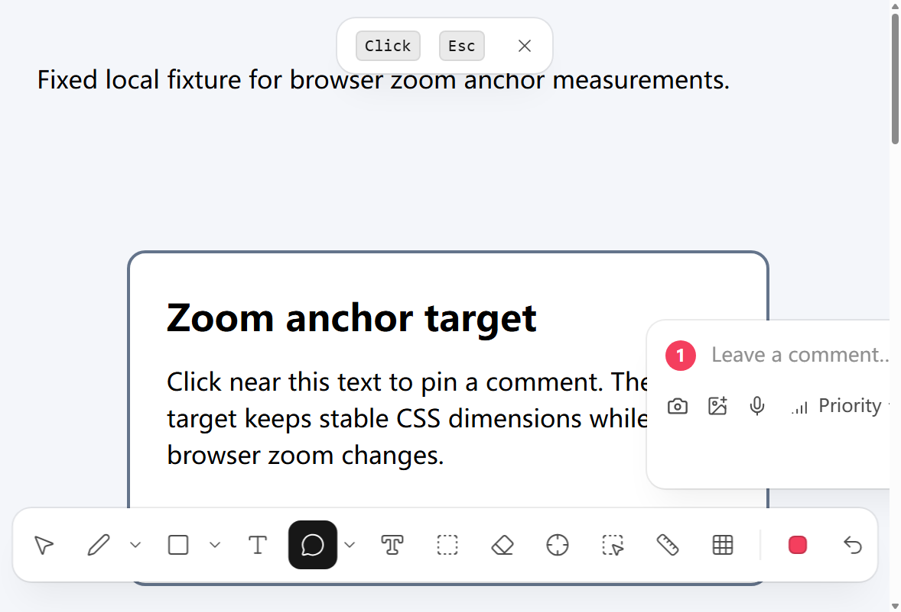
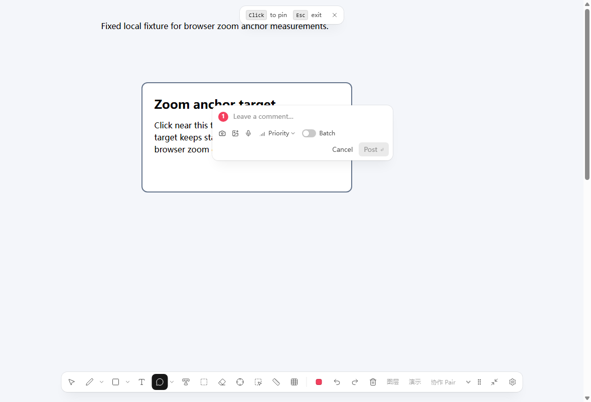
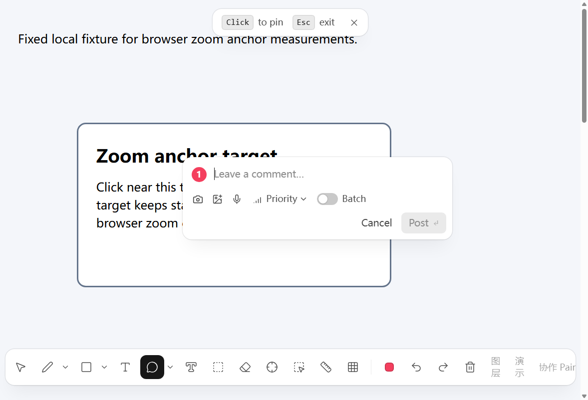
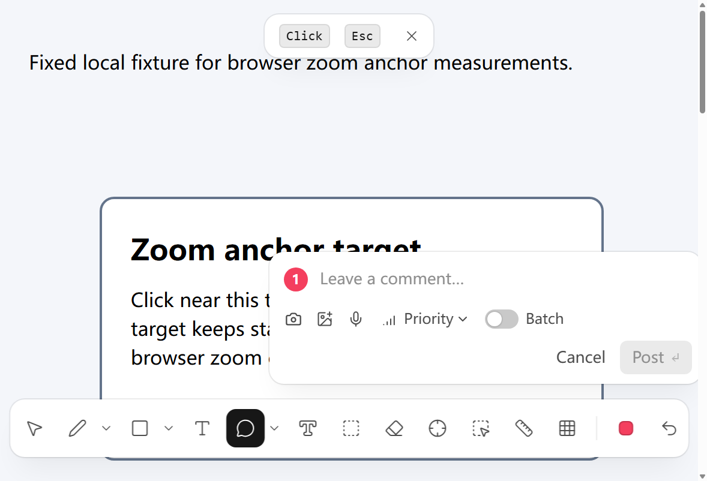

# 浏览器缩放批注定位复现与验收（2026-11-13）

## 环境与方法

- 固定页面：[`acceptance/zoom-fix-2026-11-13/fixture.html`](../acceptance/zoom-fix-2026-11-13/fixture.html)，由本机 `127.0.0.1:8791` 提供。
- 浏览器：Chrome 157.0.8103.52，headless Chrome，CDP 端口 9333；浏览器窗口边界设为 1200×900，截图视口为 1178×802。此环境是用户提供的 CDP 通道，不是 brief 指定的有窗口浏览器，因此记录为真实浏览器运行证据，但不把它描述成有窗口验收。
- 缩放：通过 Chrome 扩展 `chrome.tabs.setZoom` 设置实际浏览器缩放，页面 `devicePixelRatio` 分别读到 1、1.5、2，`innerWidth` 分别为 1178、785、589。不是用 viewport 模拟缩放。
- 点击：CDP 将合成 `MouseEvent` 派发到页面中扩展的真实捕获层；CDP 鼠标坐标命中未能穿过 shadow host 捕获层。点击路径因此不是物理鼠标输入。浏览器缩放、页面 DOM 几何、扩展 UI 和截图均来自该 Chrome 实例。
- 修复前构建自 `6948e78`；修复后构建当前分支。当前分支的基础提交 `05d5550` 已包含核心缩放重锚修复；本 PR 增加无目标元素草稿回归测试和这份浏览器验收记录。
- 期望批注框左边：`目标元素 left + 点击在目标内的 x 偏移 + 16 CSS px`。目标元素 left 在缩放下变化，点击偏移保持 126 CSS px。

## 打开批注框后缩放：修复前后

| 场景 | 缩放比 | 目标元素 left | 期望框 left | 修复前实际 / 偏差 | 修复后实际 / 偏差 |
| --- | ---: | ---: | ---: | ---: | ---: |
| 点击并打开草稿 | 100% | 281.500 | 423.500 | 423.000 / -0.500 px | 423.000 / -0.500 px |
| 放大后保持草稿打开 | 150% | 102.531 | 244.531 | 423.000 / +178.469 px | 244.031 / -0.500 px |
| 继续放大并保持草稿打开 | 200% | 82.898 | 224.898 | 423.000 / +198.102 px | 224.398 / -0.500 px |
| 还原到 100% | 100% | 281.500 | 423.500 | 423.000 / -0.500 px | 423.000 / -0.500 px |

修复前截图：

| 100% | 150% | 200% | 还原 100% |
| --- | --- | --- | --- |
|  |  |  |  |

修复后截图：

| 100% | 150% | 200% | 还原 100% |
| --- | --- | --- | --- |
|  |  |  |  |

原始矩阵读数分别保存在 [`before-metrics.json`](../acceptance/zoom-fix-2026-11-13/before-metrics.json) 和 [`after-metrics.json`](../acceptance/zoom-fix-2026-11-13/after-metrics.json)。四舍五入偏差约 -0.5 CSS px；150% 与 200% 时的大偏差由修复前的旧 left 值 423 px 与目标元素实际重排位置不一致造成。

## 点击后、Post 前缩放

在 150% 点击目标，随后切到 200% 再发布。修复前打开的框在 200% 仍留在 x=244 px；新 pin 的 x=228 px，而按点击目标快照换算的期望 x=208.898 px，偏差 +19.102 px。修复后 200% 草稿框期望 x=224.898 px、实测 x=224.367 px（-0.531 px）；发布 pin 期望 x=208.898 px、实测 x=208.367 px（-0.531 px）。

| 阶段 | 修复前 | 修复后 |
| --- | --- | --- |
| 点击 150% 后的框 | [截图](../acceptance/zoom-fix-2026-11-13/before-low-click-at-150.png) | [截图](../acceptance/zoom-fix-2026-11-13/after-low-click-at-150.png) |
| 200%、Post 前的框 | [截图](../acceptance/zoom-fix-2026-11-13/before-low-open-at-200.png) | [截图](../acceptance/zoom-fix-2026-11-13/after-low-open-at-200.png) |
| 200% 发布后的 pin | [截图](../acceptance/zoom-fix-2026-11-13/before-low-posted-at-200.png) | [截图](../acceptance/zoom-fix-2026-11-13/after-low-posted-at-200.png) |

数据：修复前 [`before-low-metrics.json`](../acceptance/zoom-fix-2026-11-13/before-low-metrics.json)，修复后 [`after-post-metrics.json`](../acceptance/zoom-fix-2026-11-13/after-post-metrics.json)。修复前页面已有先前测试 pin，因此截图可见旧标记；新建 pin 的读数取该 JSON 中第二项。修复后页面使用独立 fixture URL。

## Ctrl+0 复位说明

曾向页面 target 派发 Ctrl+0 键盘事件，但 Chrome headless/CDP 通道没有执行浏览器快捷键；读回缩放仍是 200%（`ctrl0KeyZoom: 2`）。随后用 `chrome.tabs.setZoom(1)` 执行等价的缩放复位，并读回 `actualZoom: 1`、`innerWidth: 1178`。上面的“还原 100%”矩阵行与截图因此证明的是复位后的状态，不声称验证了真实键盘 Ctrl+0。证据详见 [`after-post-metrics.json`](../acceptance/zoom-fix-2026-11-13/after-post-metrics.json) 及 `*-ctrl0-restore.png`。

## 无目标元素与代码改动

- `apps/extension/components/CommentLayer.test.tsx`：补充无 `target` 草稿在 resize/缩放后发布仍保留点击时文档坐标的回归测试，并检查点击快照的 viewport 宽度。
- `apps/extension/components/CommentLayer.tsx`：注释说明无捕获元素时没有几何对象可重新投影，因此保留存储的文档点，由浏览器按 CSS px 映射。未在 `toDoc()` 添加 DPR 或缩放逆变换。
- `acceptance/zoom-fix-2026-11-13/`：固定 fixture、修复前后矩阵和 Post 前缩放场景截图及原始 JSON 几何读数。
- `docs/zoom-repro-2026-11-13.md`：上述复现步骤、偏差表、证据边界和结果。

核心修复已经存在于分支基线 `05d5550`：点击时捕获目标几何快照、草稿跟随 `scrollTick`/`hostMutationTick` 重锚，以及 CSS zoom 变化触发几何 tick。本次变更不重复改写该实现。

## 验证

- `bun --version`：1.4.3；依赖按 `bun install --frozen-lockfile` 安装。
- `bun run lint`：通过。
- `bun run check`：通过，Turbo 12/12。
- `bun run test`：通过，Turbo 12 tasks；扩展测试 632 pass、0 fail。
- `bun run --cwd apps/extension build`：通过。
- 单独从仓库根目录运行裸 `bun test` 不通过：它绕过 workspace 的测试脚本和扩展 `bunfig.toml` preload，直接发现其它 workspace 测试，导致 DOM 测试环境缺失。仓库定义并通过的全量入口是 `bun run test`。
